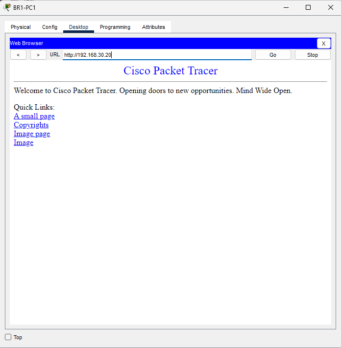
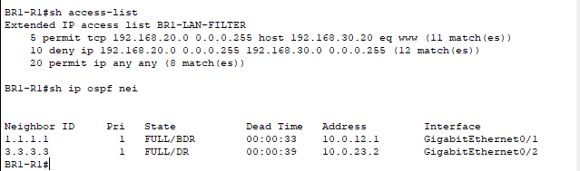
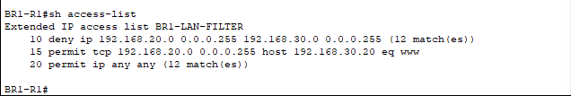
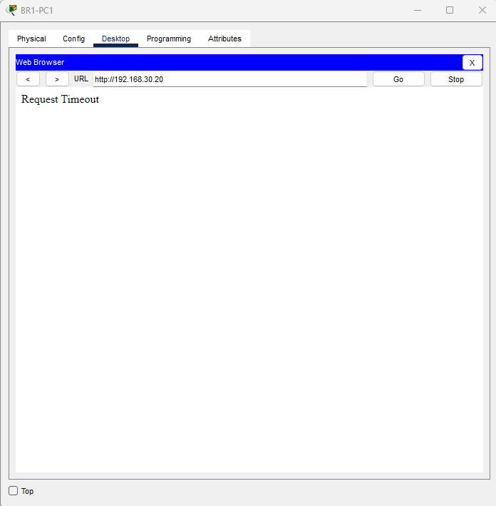
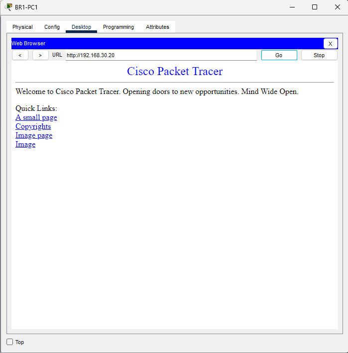

# Multisite ACL Service Filtering and Troubleshooting

## Overview

I extended my multisite Cisco Packet Tracer network by adding a web server at BR2 and allowing BR1 to access its HTTP service while keeping other BR1-to-BR2 LAN traffic blocked. I then deliberately placed the HTTP permit below the broader deny, reproduced a browser timeout, and restored access by correcting the rule order.

This guided personal lab was completed by Michael Bessard to develop network engineering and cybersecurity troubleshooting skills.

## Environment and addressing

The lab uses Cisco Packet Tracer 8.2.2, three Cisco 2911 routers, three Cisco 2960 switches, three PCs, and a Server-PT device. It builds on my [multisite OSPF](https://github.com/mikemsb81/multisite-ospf-deployment) and [ACL segmentation](https://github.com/mikemsb81/multisite-acl-segmentation) projects.

| Device | IPv4 address | Default gateway |
| --- | --- | --- |
| HQ-PC1 | 192.168.10.10/24 | 192.168.10.1 |
| BR1-PC1 | 192.168.20.10/24 | 192.168.20.1 |
| BR2-PC1 | 192.168.30.10/24 | 192.168.30.1 |
| BR2-WEB01 | 192.168.30.20/24 | 192.168.30.1 |

BR2-WEB01 connects to BR2's access switch and has HTTP enabled. The branch LANs use OSPF areas 10 and 20; all WAN links remain in area 0. The underlying network includes a branch-to-branch backup link, but WAN failover was not repeated during this service-filtering exercise.

## Intended policy

| Traffic entering BR1 from its LAN | Action |
| --- | --- |
| BR1 LAN to BR2-WEB01, TCP destination port 80 | Permit |
| Other BR1 LAN traffic to 192.168.30.0/24 | Deny |
| All other IPv4 traffic | Permit |

The ACL is applied inbound on BR1-R1 GigabitEthernet0/0, where packets arrive from BR1's LAN.

This is a specific service exception within an otherwise blocked destination subnet. Traffic to other destinations remains broadly permitted.

## Working ACL

```text
ip access-list extended BR1-LAN-FILTER
5 permit tcp 192.168.20.0 0.0.0.255 host 192.168.30.20 eq 80
10 deny ip 192.168.20.0 0.0.0.255 192.168.30.0 0.0.0.255
20 permit ip any any
!
interface GigabitEthernet0/0
 ip access-group BR1-LAN-FILTER in
```

Cisco displays TCP port 80 as `www` in the ACL output. The `host` keyword restricts the exception to 192.168.30.20. Rules are evaluated in order, and processing stops at the first match.

## Baseline verification

Before changing the ACL, BR2-PC1 could ping the server and open its HTTP page, confirming the local server setup.

After adding the HTTP exception, I tested from BR1-PC1:

| Test | Observed result |
| --- | --- |
| Browse to http://192.168.30.20 | Page loaded |
| Ping 192.168.30.20 | Blocked; four packets lost |
| Ping HQ-PC1 at 192.168.10.10 | Successful |
| Check BR1's OSPF neighbors | HQ and BR2 both FULL |



The recorded ACL output showed 11 matches on rule 5, 12 on rule 10, and eight on rule 20. These counters were cumulative and included earlier tests; they are packet counts, not counts of browser visits.



## Fault: HTTP permit shadowed by a broader deny

I removed the permit at sequence 5 and inserted the same permit at sequence 15:

```text
configure terminal
ip access-list extended BR1-LAN-FILTER
no 5
15 permit tcp 192.168.20.0 0.0.0.255 host 192.168.30.20 eq 80
end
show access-lists
```

The resulting order was:

| Sequence | Rule |
| --- | --- |
| 10 | Deny BR1 LAN traffic to BR2 LAN |
| 15 | Permit HTTP to BR2-WEB01 |
| 20 | Permit everything else |



After reopening the browser on BR1-PC1 and requesting the server page, the browser displayed **Request Timeout**.



### Root cause

The HTTP request matched rule 10 because its source was in 192.168.20.0/24 and its destination was in 192.168.30.0/24. The router denied it before reaching rule 15. The HTTP permit was therefore shadowed by the earlier, broader deny.

Adding a correct permit is insufficient if a preceding rule already denies the same traffic.

## Fix and verification

I restored the specific HTTP permit above the broader deny:

```text
configure terminal
ip access-list extended BR1-LAN-FILTER
no 15
5 permit tcp 192.168.20.0 0.0.0.255 host 192.168.30.20 eq 80
end
show access-lists
```

From BR1-PC1, I reopened the server page and confirmed that HTTP worked again. I also repeated the ping to 192.168.30.20 and confirmed that all four packets were still blocked.



| State | HTTP to server | Ping to server |
| --- | --- | --- |
| Correct order: permit 5, deny 10 | Allowed | Blocked |
| Incorrect order: deny 10, permit 15 | Timed out | No additional ping test recorded in this state |
| Correct order restored | Allowed | Blocked |

I saved the corrected BR1 configuration with `copy running-config startup-config` and saved the Packet Tracer project.

## Project files

- [multisite-service-filtering.pkt](multisite-service-filtering.pkt): Working service-filtering checkpoint before the deliberate ordering fault.
- [multisite-acl-order-troubleshooting.pkt](multisite-acl-order-troubleshooting.pkt): Corrected project after reproducing and resolving the fault.

Both files contain working configurations. To reproduce the failure, open a copy of the troubleshooting project and apply the fault commands above; use the fix commands to restore service.

## Scope and limitations

This ACL performs stateless IPv4 packet filtering by address, protocol, and port. It does not inspect HTTP content or track connection state. Allowing destination TCP port 80 is a port-based rule, not proof that the payload is HTTP.

Only BR1's inbound LAN interface has this filter. Server responses return through BR1's WAN interface and leave through its LAN interface, so they do not encounter this inbound ACL. This is not a stateful firewall or complete bidirectional isolation policy.

HTTP was used to demonstrate the port exception in the simulator. HTTPS, TCP/UDP services other than HTTP, and security of the web application itself were not tested. The ping results demonstrate ICMP filtering, not a server outage.

## Lessons learned

- A failed ping can coexist with a working application service.
- Specific exceptions must precede broader rules that would otherwise match them.
- ACL counters count matching packets and can include earlier tests.
- Application tests and routing checks answer different troubleshooting questions.
- A fix should restore the required service while preserving the intended restriction.

